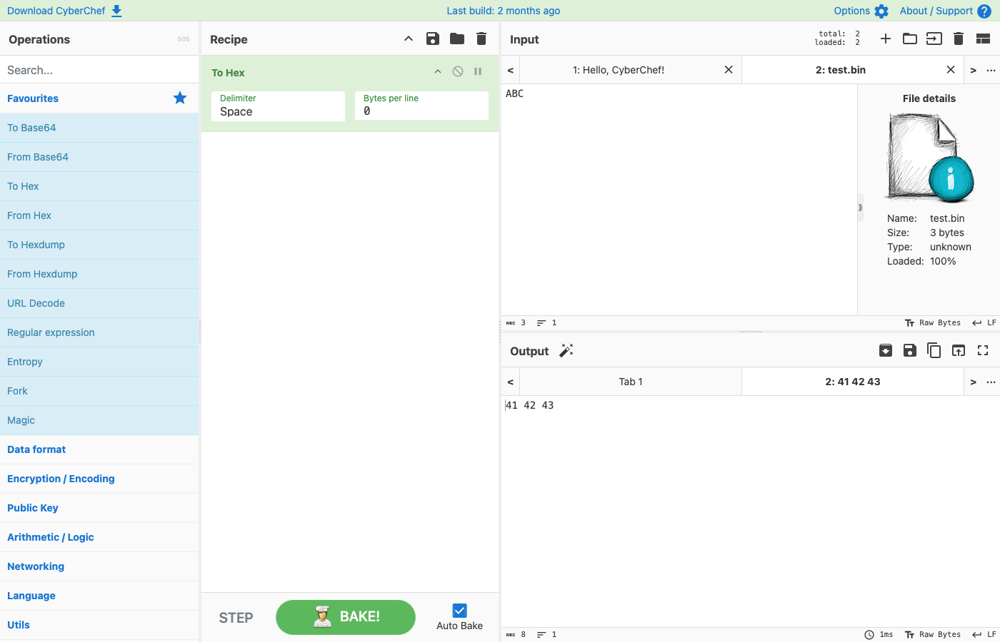

# CyberChef for VS Code (Offline)

**The Cyber Swiss Army Knife, inside VS Code. No internet required.**

This extension embeds the complete [GCHQ CyberChef](https://github.com/gchq/CyberChef) web app (the same UI you know from <https://gchq.github.io/CyberChef/>) in a VS Code editor panel. The CyberChef build ships inside the extension and is served from your own machine, so it works on air-gapped networks and never sends your data anywhere.



## Features

- **Identical CyberChef UI/UX.** Operations list, drag-and-drop recipe builder, Bake / Step / Auto Bake, Magic, multiple input/output tabs, file inputs, breakpoints, favourites, saved recipes and all five themes. It is the unmodified official release (currently **v11.5.0**, 500+ operations).
- **100% offline.** All operations, lazily loaded modules, web workers, OCR language data and fonts are bundled.
- **Editor integration**
  - **CyberChef: Send Selection to Input** (editor right-click menu). Sends the selection, or the whole file if nothing is selected, to the CyberChef input.
  - **CyberChef: Send File to Input** (Explorer right-click menu). Loads any file (binary-safe) as a CyberChef input tab.
  - **Insert Output into Editor** / **Open Output in New Editor** / **Copy Output to Clipboard**. These are buttons in the CyberChef panel's title bar, and also in the Command Palette.
  - **CyberChef: Load Recipe…** accepts Chef format (`From_Base64('A-Za-z0-9+/=',true)`), JSON, or a full CyberChef URL containing `#recipe=…`.
- **Native VS Code feel**
  - Theme follows VS Code (light → *Classic*, dark → *Dark*), or pick any CyberChef theme.
  - CyberChef's *Save output to file* / *Save recipe* use VS Code's native save dialog.
  - CyberChef prompts (e.g. *Go to tab*) appear as VS Code input boxes.
  - External links (wiki, GitHub) open in your browser.
  - The panel keeps its state when hidden and restores the recipe after a window reload.

## Usage

1. Open the Command Palette (`Ctrl/Cmd+Shift+P`) and run **CyberChef: Open**.
2. Build a recipe exactly as on the website: drag operations from the left into the Recipe column.
3. Type or paste into **Input**, or right-click selected text in any editor and choose **CyberChef: Send Selection to Input**.
4. Use the panel's title-bar buttons to copy the output, open it in a new editor, or insert it at the cursor or selection of the last active editor.

## Settings

| Setting | Default | Description |
| --- | --- | --- |
| `cyberchef.theme` | `auto` | `auto` follows VS Code. `cyberchef` keeps the theme selected in CyberChef's Options. Or force `classic`, `dark`, `geocities`, `solarizedDark` or `solarizedLight`. |
| `cyberchef.server.port` | `47817` | Preferred port of the local loopback server. CyberChef stores options, favourites and saved recipes per origin, so a stable port keeps them across sessions. Falls back to a random port if busy; `0` = always random. |
| `cyberchef.openBeside` | `false` | Open the panel beside the active editor. |

## How it works

```
VS Code ── webview panel ── <iframe http://127.0.0.1:<port>/> ── CyberChef (unmodified)
   ▲             │                                │
   │             └──── postMessage ─────── vscode-bridge.js (injected)
   └── extension host: loopback-only static server + commands
```

- The extension starts a tiny static HTTP server bound to **127.0.0.1 only** and serves the bundled CyberChef build. Serving over HTTP keeps CyberChef same-origin with its web workers and lazily loaded modules, so it behaves exactly like the hosted site. Loading it straight from the webview's resource scheme breaks those.
- The webview contains a full-size iframe of that page. A small bridge script, [`media/bridge.js`](media/bridge.js), is injected into CyberChef's `index.html`. It uses CyberChef's public `window.app` API to set input, load recipes, read the output and change theme. It also routes downloads, `prompt()` dialogs and external links to VS Code.
- The prompt endpoint is protected by a random per-session token. The server only answers `GET`/`HEAD`, and only serves files inside the bundled build.
- In remote setups (SSH, WSL, Codespaces) the extension prefers to run on the UI side (`extensionKind: ["ui", "workspace"]`), so CyberChef still runs locally.

## Building from source

Requirements: Node.js 18+ and npm.

```bash
git clone https://github.com/chamnan/CyberChef-vscode.git
cd CyberChef-vscode
npm install
npm run fetch-cyberchef   # downloads the pinned CyberChef release into ./cyberchef (one-time, needs internet)
npm test                  # compiles and runs the unit tests
```

- **Debug:** open the folder in VS Code and press `F5` (*Run Extension*).
- **Package:** `npm run package` produces `cyberchef-vscode-<version>.vsix`.
- **Install the VSIX:** `code --install-extension cyberchef-vscode-0.1.0.vsix`, or *Extensions view → … → Install from VSIX…*. Once installed, no internet connection is ever needed.

### Updating CyberChef

The bundled version is pinned in `package.json`:

```json
"cyberchef": { "version": "v11.5.0" }
```

Change it to another [CyberChef release tag](https://github.com/gchq/CyberChef/releases), then run `npm run fetch-cyberchef -- --force` and re-package.

### Releases

GitHub Actions ([`.github/workflows/build.yml`](.github/workflows/build.yml)) builds and tests every push and uploads the `.vsix` as an artifact. Pushing a tag like `v0.1.0` also publishes a GitHub Release with the `.vsix` attached.

## Project layout

```
├── src/
│   ├── extension.ts        # activation, commands, public API
│   ├── panel.ts            # webview panel, message relay, save dialog, theme sync
│   ├── server.ts           # loopback static server + bridge injection + prompt endpoint
│   ├── recipe.ts           # recipe / CyberChef URL parsing
│   └── test/server.test.ts # unit tests (npm test)
├── media/
│   ├── bridge.js           # runs inside the CyberChef page
│   └── icon.png
├── scripts/fetch-cyberchef.mjs  # downloads + unpacks the pinned CyberChef release
└── cyberchef/              # (generated, git-ignored) the CyberChef build that gets bundled
```

## Known limitations

- Dragging files from your OS straight into the panel may be intercepted by VS Code's editor drop handling. Use **Send File to Input** (Explorer right-click) or CyberChef's *Open input file* button instead.
- Options, favourites and saved recipes live in CyberChef's own browser storage for the panel's origin. Changing `cyberchef.server.port` starts with fresh storage.

## Credits & license

- [CyberChef](https://github.com/gchq/CyberChef) is © Crown Copyright and licensed under the Apache License 2.0. This extension bundles an unmodified release build; see [NOTICE](NOTICE).
- This extension is licensed under the [Apache License 2.0](LICENSE). It is an independent project, not affiliated with or endorsed by GCHQ.
